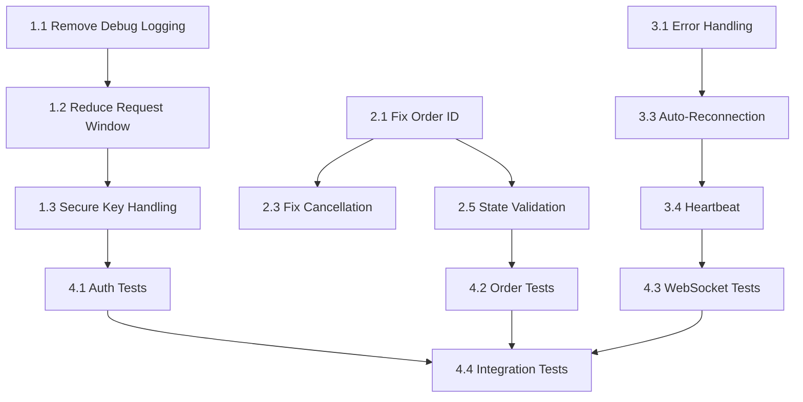

# Implementation Roadmap - Backpack Exchange Critical Fixes

## Overview
This roadmap outlines the implementation order and dependencies for fixing critical issues in the Backpack Exchange connector. The approach follows Test-Driven Development (TDD) principles.

## Related Issues
- **Review Summary**: `/Users/han/github/hummingbot/issues/REVIEW_SUMMARY.md`
- **Total Issues**: 68 (15 Critical, 23 High, 18 Medium, 12 Low)

## Implementation Phases

### Phase 1: Critical Security (Day 1) ✅ COMPLETED
**Goal**: Remove immediate security vulnerabilities

#### Tasks (File: 01-authentication-security-fixes.md)
1. [x] Task 1.1: Remove debug logging of sensitive data
2. [x] Task 1.2: Reduce request window (5000ms → 1000ms)
3. [x] Task 1.3: Secure private key handling
4. [x] Task 1.4: Fix demo mode credential risk
5. [x] Task 1.5: Improve instruction determination

**Deliverables**:
- Zero sensitive data in logs
- Reduced replay attack window
- Secure key handling implementation

### Phase 2: Order Management (Day 1-2)
**Goal**: Fix order ID collisions and race conditions

#### Tasks (File: 02-order-management-fixes.md)
1. [ ] Task 2.1: Fix client order ID generation
2. [ ] Task 2.2: Fix error response handling
3. [ ] Task 2.3: Fix order cancellation race condition
4. [ ] Task 2.4: Fix balance calculation logic
5. [ ] Task 2.5: Implement order state validation
6. [ ] Task 2.6: Add idempotency for operations

**Deliverables**:
- Zero order ID collisions
- Proper error handling
- Accurate balance calculations

### Phase 3: WebSocket Reliability (Day 2-3)
**Goal**: Ensure stable and resilient WebSocket connections

#### Tasks (File: 03-websocket-reliability-fixes.md)
1. [ ] Task 3.1: Add error handling in message processing
2. [ ] Task 3.2: Fix timestamp conversion
3. [ ] Task 3.3: Implement auto-reconnection
4. [ ] Task 3.4: Implement heartbeat mechanism
5. [ ] Task 3.5: Handle message queue overflow
6. [ ] Task 3.6: Add state management

**Deliverables**:
- 100% uptime in 24-hour test
- Auto-recovery from disconnections
- Consistent data processing

### Phase 4: Testing & Validation (Day 3-4)
**Goal**: Comprehensive test coverage and validation

#### Tasks (File: 04-test-implementation-plan.md)
1. [ ] Task 4.1: Authentication security tests
2. [ ] Task 4.2: Order management tests
3. [ ] Task 4.3: WebSocket reliability tests
4. [ ] Task 4.4: Integration tests
5. [ ] Task 4.5: Test utilities and fixtures

**Deliverables**:
- >80% test coverage
- All tests passing
- Performance benchmarks met

## Priority Matrix

| Priority | Severity | Tasks | Timeline |
|----------|----------|-------|----------|
| P0 | CRITICAL | 1.1, 1.2, 2.1 | Day 1 AM |
| P1 | CRITICAL | 1.3, 2.3, 2.4 | Day 1 PM |
| P2 | HIGH | 3.1, 3.3 | Day 2 AM |
| P3 | HIGH | 3.4, 2.5 | Day 2 PM |
| P4 | MEDIUM | 3.2, 3.5, 3.6 | Day 3 |

## Dependencies

## Success Metrics

### Security
- [x] 0 sensitive data items in logs
- [x] Request window ≤ 5 seconds (reduced to 1s default, 5s max)
- [x] Keys cleared from memory after use

### Reliability
- [ ] 0 order ID collisions in 10,000 orders
- [ ] 100% WebSocket uptime in 24h test
- [ ] <5s average reconnection time

### Quality
- [ ] >80% test coverage overall
- [ ] >90% coverage for critical paths
- [ ] All existing tests still passing

### Performance
- [ ] Order placement <100ms
- [ ] WebSocket message processing >1000 msg/s
- [ ] Memory usage stable over 24h

## Risk Mitigation

### Rollback Plan
1. Tag current version before changes
2. Create feature branch for fixes
3. Test on testnet before mainnet
4. Keep old implementation available

### Testing Strategy
1. Unit tests first (TDD)
2. Integration tests on testnet
3. 24-hour stability test
4. Performance benchmarking

### Communication
1. Update REVIEW_SUMMARY.md after each fix
2. Document breaking changes
3. Create migration guide if needed

## Next Steps After Completion

### Short Term (Week 2)
- [ ] Add signature verification for server responses
- [ ] Implement circuit breaker pattern
- [ ] Add comprehensive logging (without sensitive data)

### Medium Term (Week 3-4)
- [ ] Refactor common code into base class
- [ ] Add performance optimizations
- [ ] Implement monitoring and alerting

### Long Term (Month 2)
- [ ] Add advanced order types
- [ ] Implement WebSocket compression
- [ ] Add automated performance testing

## Notes
- All changes must maintain backward compatibility
- Each fix should be independently testable
- Documentation updates required for each phase
- Consider security audit after implementation